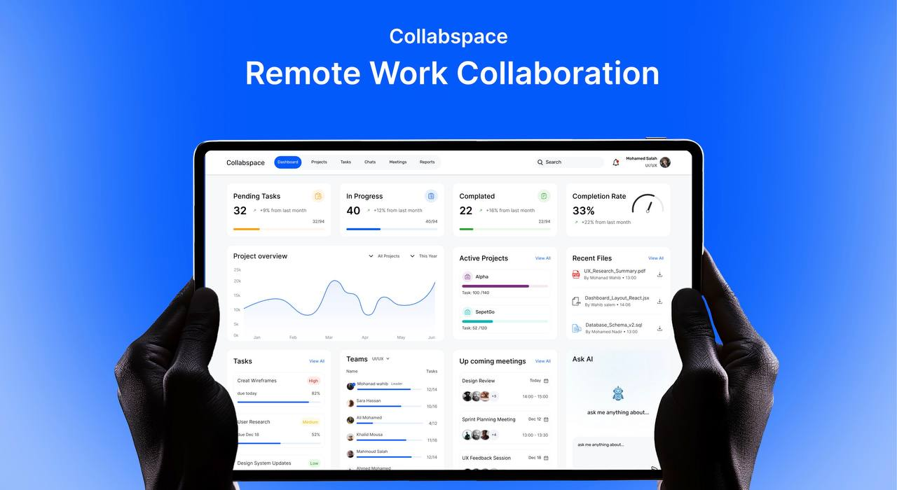
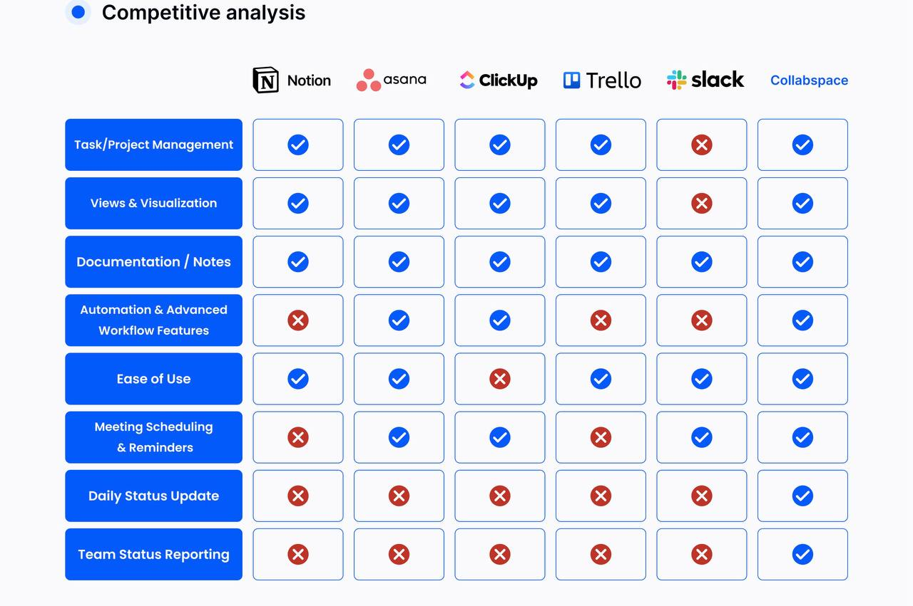
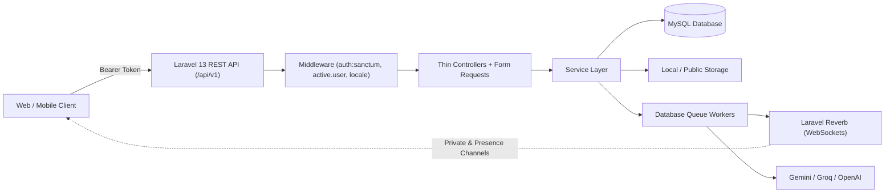
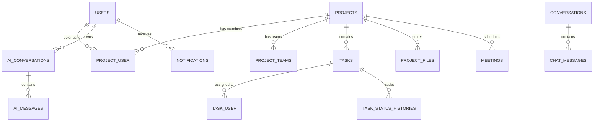

<p align="center">
  
</p>

<h1 align="center">CollabSpace</h1>

<p align="center">
  <strong>A Unified Remote Work Collaboration &amp; Project Management Platform</strong>
</p>

<p align="center">
  CollabSpace is a production-oriented Laravel 13 REST API backend that brings project management, Kanban task execution, team collaboration, real-time messaging, video meetings with AI transcription &amp; summarization, reporting, notifications, and a workspace-aware AI assistant into a single cohesive platform.
</p>

<p align="center">
  
  
  
  
  
  
</p>

---

## Table of Contents

- [About CollabSpace](#about-collabspace)
- [The Problem](#the-problem)
- [Our Solution](#our-solution)
- [Comparative Analysis](#comparative-analysis)
- [Key Features](#key-features)
- [Backend-Supported UI &amp; Dashboard Capabilities](#backend-supported-ui--dashboard-capabilities)
- [Technical Architecture](#technical-architecture)
- [Technology Stack](#technology-stack)
- [Authentication &amp; Authorization](#authentication--authorization)
- [Database Design](#database-design)
- [API Documentation &amp; Postman](#api-documentation--postman)
- [Installation &amp; Local Setup](#installation--local-setup)
- [Environment Variables &amp; External Integrations](#environment-variables--external-integrations)
- [Testing &amp; Code Quality](#testing--code-quality)
- [Project Structure](#project-structure)
- [Security &amp; Engineering Practices](#security--engineering-practices)
- [Roadmap](#roadmap)
- [Contributing](#contributing)
- [License](#license)
- [Acknowledgements](#acknowledgements)

---

## About CollabSpace

**CollabSpace** is an API-first backend platform built for remote and distributed teams. Rather than forcing teams to juggle separate tools for task boards, chat channels, file sharing, video meetings, daily status reports, and AI assistance, CollabSpace connects these workflows under a unified permission-aware workspace.

It is designed for:
- **Engineering &amp; Product Teams** managing sprints, Kanban boards, reviewers, and deliverables.
- **Project Managers** tracking progress, overdue tasks, team workloads, and daily/weekly status reports.
- **Remote Organizations** needing real-time communication, scheduled video meetings with automated transcripts/summaries, and centralized project files.

---

## The Problem

Remote and distributed teams frequently struggle with operational friction caused by disconnected tooling:

1. **Fragmented Tooling:** Tasks live in one app, chat in another, meetings in a third, and files in scattered cloud folders.
2. **Unclear Task Ownership &amp; Progress:** Without structured reviewers, status histories, and Kanban workflows, blockers go unnoticed.
3. **Lack of Visibility:** Managers lack a consolidated view of project health, overdue work, and team performance.
4. **Inefficient Meeting Follow-Ups:** Action items and decisions are lost when meetings lack integrated transcripts and summaries.
5. **No Unified Status Reporting:** Daily and team status updates are often ad-hoc or buried in chat threads.
6. **Repetitive Context Switching:** Searching across projects, tasks, files, and meetings requires checking multiple systems.

---

## Our Solution

CollabSpace addresses these challenges with a single, connected backend architecture:

- **Unified Workspace:** Projects, teams, tasks, files, chats, meetings, reports, and notifications share one relational data model and contextual permission system.
- **Connected Workflows:** Task status transitions are automatically logged (`task_status_histories`), project/task/chat/meeting events trigger queued in-app + real-time notifications, and meetings can be transcribed and summarized asynchronously.
- **Workspace-Aware AI Assistant:** Powered by Google Gemini with strict allowlisted tool-calling (`WorkspaceContextBuilder`), users can ask natural-language questions about their authorized projects, overdue tasks, teams, and upcoming meetings.
- **Bilingual Support:** Full English and Arabic (`en` / `ar`) localization across API responses and notifications.

---

## Comparative Analysis

The chart below positions **CollabSpace** against widely used collaboration and project management platforms (**Notion**, **Asana**, **ClickUp**, **Trello**, and **Slack**) across core remote-work capabilities:

<p align="center">
  
</p>

As illustrated in the comparison:
- **Task/Project Management &amp; Views:** Supported by Notion, Asana, ClickUp, Trello, and CollabSpace (absent in Slack).
- **Documentation / Notes:** Supported across all compared platforms.
- **Automation &amp; Advanced Workflow Features:** Supported by Asana, ClickUp, and CollabSpace.
- **Ease of Use:** Prioritized in Notion, Asana, Trello, Slack, and CollabSpace.
- **Meeting Scheduling &amp; Reminders:** Supported by Asana, ClickUp, Slack, and CollabSpace.
- **Daily Status Update &amp; Team Status Reporting:** Purpose-built into CollabSpace as first-class modules alongside project execution.

---

## Key Features

### 1. Project Management
- Create, update, archive, and soft-delete projects with status (`active`, `completed`, `archived`), priority (`low`, `medium`, `high`), start dates, deadlines, and timeline progress calculation.
- Contextual project membership with `project_manager` and `member` roles, including **Last Project Manager protection** to prevent orphaned projects.

### 2. Task Management
- Full task lifecycle with `todo`, `in_progress`, `in_review`, and `completed` statuses, priorities, progress percentage (auto-set to `100%` on completion), due dates, and reviewer assignment.
- **Kanban Board &amp; Global Task Views:** Project-scoped and cross-project Kanban endpoints with deterministic positioning, filtering, and search.
- **Task Status History:** Automatic audit trail (`task_status_histories`) recording every status transition.

### 3. Team Collaboration
- Organize project members into color-coded **Project Teams** with designated team leaders and per-member role titles.
- Aggregated team member task metrics (assigned vs. completed counts).

### 4. File Management
- Secure project file uploads and downloads with MIME/extension metadata, uploader tracking, and search.
- Automatic orphan-file cleanup on database transaction failure.

### 5. Chats &amp; Real-Time Communication
- **Direct Conversations**, **Project Channels**, and **Team Channels** with participant read-tracking (`last_read_message_id`, `last_read_at`).
- **Message Threads &amp; Replies**, file attachments, and **Voice/Video Call** initiation/ending events.
- Real-time broadcasting via **Laravel Reverb** (`MessageSent`, `MessageUpdated`, `MessageDeleted`, `MessagesRead`, `ThreadReplySent`, `UserTyping`, `CallInitiated`, `CallEnded`).

### 6. Meetings &amp; AI Summarization
- Schedule, update, and cancel meetings with **Jitsi Meet** room generation, participant RSVP tracking, and attendance timestamps.
- Meeting notes, comments, recordings, transcripts, and AI-generated summaries/key points via queued jobs (`TranscribeMeetingRecordingJob`, `SummarizeMeetingTranscriptJob`) using **Groq / OpenAI Whisper** and **Google Gemini**.

### 7. Dashboard &amp; Analytics
- Consolidated dashboard endpoint (`GET /api/v1/dashboard`) returning KPI cards, project progress, task status breakdowns, team performance, recent files, and upcoming meetings.

### 8. Reports
- Dedicated Reports module (`GET/POST/PUT/DELETE /api/v1/reports`) for structured status reporting tied to users and projects.

### 9. Notifications
- **Database + Real-Time Broadcast** (via Laravel Reverb private `user.{id}` channels) queued for asynchronous delivery—no email clutter.
- Covers 25+ domain events across Projects, Tasks, Teams, Files, Chats (with unread-only suppression), Meetings, and AI Attachment Processing.
- Automated hourly **Task Due-Date Reminders** (`notifications:send-task-reminders`) for tasks due within 24 hours and overdue tasks, deduplicated via `task_reminder_logs`.

### 10. Global Search
- Unified search (`GET /api/v1/search`) across authorized projects, tasks, files, and meetings.

### 11. CollabSpace AI Assistant (Ask AI)
- Multi-turn AI conversations (`ai_conversations`, `ai_messages`) powered by **Google Gemini** (`gemini-2.5-flash`).
- **Workspace-Aware Tool Calling:** Uses `WorkspaceContextBuilder` to safely query authorized tasks, overdue items, project summaries, team overviews, upcoming meetings, and workspace search.
- **Asynchronous Attachment Analysis:** Queued `ProcessAiAttachmentJob` for analyzing uploaded documents/images, plus message regeneration and thumbs-up/down feedback.

---

## Backend-Supported UI &amp; Dashboard Capabilities

> **Note:** This repository contains the Laravel REST API backend only (frontend/mobile source code is separate). The API directly powers the following client widgets and interfaces:

- **Dashboard KPI &amp; Analytics Widgets:** Active projects, task completion rates, overdue counts, and team performance metrics.
- **Kanban Task Board:** Column-grouped tasks (`todo`, `in_progress`, `in_review`, `completed`) with drag-and-drop position updates.
- **Real-Time Chat &amp; Thread Drawer:** Live messages, typing indicators, presence channels (`presence-conversation.{id}`), and threaded replies.
- **Meeting Room &amp; Summary Panel:** Jitsi join URLs, RSVP controls, transcripts, and AI summaries.
- **Notification Center:** Paginated feed, `all`/`unread` filter, unread badge count, mark-as-read, and clear-all actions.
- **Global Search Bar &amp; Ask AI Chat:** Instant cross-resource search and conversational AI assistant.

---

## Technical Architecture

CollabSpace follows a clean, layered Laravel 13 architecture:

```
Routes → Middleware → Form Requests → Thin Controllers → Services → Models → API Resources → Policies → Enums
```



### Key Architectural Decisions
- **API-First &amp; Versioned:** All endpoints live under `/api/v1` with standardized `ApiResponse` (`data` / `meta` on success, `error.code` / `error.message` / `error.details` on failure).
- **Thin Controllers, Rich Services:** Business logic, database transactions (`DB::transaction`, `DB::afterCommit`), and authorization checks live in dedicated Services and Policies.
- **No Unnecessary Abstractions:** Follows Laravel conventions directly without redundant repository/DTO layers.
- **Async by Default:** Heavy operations (AI attachments, meeting transcription/summarization, notifications) run on `database` queues.

---

## Technology Stack

| Category | Technology |
|---|---|
| **Backend Framework** | Laravel `^13.17` |
| **Language** | PHP `^8.3` |
| **Database** | MySQL (InnoDB) |
| **Authentication** | Laravel Sanctum `^4.0` + Laravel Socialite (Google OAuth) |
| **Real-Time / WebSockets** | Laravel Reverb `^1.14` |
| **Queues &amp; Scheduling** | Laravel Database Queue + Laravel Scheduler |
| **Video Meetings** | Jitsi Meet (`meet.jit.si` or self-hosted) |
| **AI &amp; Transcription** | Google Gemini (`gemini-2.5-flash`), Groq / OpenAI Whisper |
| **Testing** | Pest `^4.7` + `pest-plugin-laravel` |
| **Code Quality** | Laravel Pint `^1.27` |
| **CI/CD** | GitHub Actions (`.github/workflows/ci.yml`) |
| **API Collections** | Postman (`postman/*.postman_collection.json`) |

---

## Authentication &amp; Authorization

- **Authentication:** Sanctum Bearer token authentication (`auth:sanctum`) with registration, login, logout, password reset, and Google OAuth via Laravel Socialite.
- **Account Status Enforcement:** The `active.user` middleware (`EnsureAccountNotSuspended`) blocks suspended accounts across all protected routes.
- **System Roles (`SystemRole`):** `admin` and `user`.
- **Contextual Project Roles (`ProjectRole`):** `project_manager` and `member` stored on `project_user` pivot.
- **Resource Policies:** Dedicated policies (`ProjectPolicy`, `TaskPolicy`, `ProjectTeamPolicy`, `ProjectFilePolicy`, `ReportPolicy`, `ChatThreadPolicy`, `AiConversationPolicy`) enforce ownership and project-level access, preventing IDOR.

---

## Database Design



---

## API Documentation &amp; Postman

- **Base URL:** `/api/v1`
- **Headers:**
  - `Accept: application/json`
  - `Authorization: Bearer <token>`
  - `Accept-Language: en` or `ar` (optional, for localized responses)
- **Postman Collections:** 11 ready-to-import collections are available in `postman/`:
  - `01_authentication.postman_collection.json`
  - `02_projects_teams.postman_collection.json`
  - `03_tasks.postman_collection.json`
  - `04_project_files.postman_collection.json`
  - `05_reports.postman_collection.json`
  - `06_profile_settings.postman_collection.json`
  - `07_chats.postman_collection.json`
  - `08_meetings.postman_collection.json`
  - `09_dashboard.postman_collection.json`
  - `10_ask_ai.postman_collection.json`
  - `11_notifications.postman_collection.json`

---

## Installation &amp; Local Setup

### Prerequisites
- **PHP** 8.3+ (with `pdo_mysql`, `mbstring`, `openssl`, `fileinfo`, `curl`, `zip` extensions)
- **Composer** 2.x
- **MySQL** 8.0+

### Setup Steps

1. **Clone the repository**
   ```bash
   git clone https://github.com/Menna-Baligh/CollabSpace.git
   cd CollabSpace
   ```

2. **Install dependencies**
   ```bash
   composer install
   ```

3. **Configure environment**
   ```bash
   cp .env.example .env
   php artisan key:generate
   ```
   Update `DB_DATABASE`, `DB_USERNAME`, and `DB_PASSWORD` in `.env`.

4. **Run migrations &amp; seed demo data (optional)**
   ```bash
   php artisan migrate
   php artisan db:seed --class=AiDemoSeeder
   ```

5. **Create storage symlink**
   ```bash
   php artisan storage:link
   ```

6. **Start the application**
   ```bash
   php artisan serve
   ```

7. **Run Queue Worker &amp; Scheduler (for async jobs, notifications &amp; reminders)**
   ```bash
   php artisan queue:work --tries=3
   php artisan schedule:work
   ```

8. **Run Laravel Reverb (optional, for real-time WebSockets)**
   Set `BROADCAST_CONNECTION=reverb` in `.env`, then run:
   ```bash
   php artisan reverb:start
   ```

---

## Environment Variables &amp; External Integrations

| Group | Variables | Required? | Purpose |
|---|---|---|---|
| **App &amp; DB** | `APP_KEY`, `DB_CONNECTION`, `DB_DATABASE`, `DB_USERNAME`, `DB_PASSWORD` | Mandatory | Core Laravel &amp; MySQL connection |
| **Google OAuth** | `GOOGLE_CLIENT_ID`, `GOOGLE_CLIENT_SECRET`, `GOOGLE_REDIRECT_URI` | Optional | Social login via Google |
| **Laravel Reverb** | `BROADCAST_CONNECTION=reverb`, `REVERB_APP_ID`, `REVERB_APP_KEY`, `REVERB_APP_SECRET` | Optional | Real-time chat &amp; notifications |
| **Jitsi Meet** | `JITSI_DOMAIN`, `JITSI_APP_ID`, `JITSI_SECRET` | Optional | Video meetings (defaults to `meet.jit.si`) |
| **Google Gemini** | `GEMINI_API_KEY`, `GEMINI_MODEL` | Optional | Ask AI assistant &amp; meeting summaries |
| **Whisper STT** | `GROQ_API_KEY` or `OPENAI_API_KEY` | Optional | Meeting recording transcription |

---

## Testing &amp; Code Quality

The project uses **Pest** for feature testing and **Laravel Pint** for code formatting.

```bash
# Run the full test suite
php artisan test

# Check code style with Laravel Pint
./vendor/bin/pint --test
```

CI runs automatically on GitHub Actions via `.github/workflows/ci.yml`.

---

## Project Structure

```text
CollabSpace/
├── app/
│   ├── Console/Commands/       # Scheduled commands (e.g., SendTaskReminders)
│   ├── Enums/                  # Domain enums (ProjectRole, TaskStatus, etc.)
│   ├── Events/                 # Broadcast events (MessageSent, ThreadReplySent, etc.)
│   ├── Http/
│   │   ├── Controllers/Api/V1/ # Thin versioned API controllers
│   │   ├── Middleware/         # Auth, active.user, locale middleware
│   │   ├── Requests/           # Form Request validation classes
│   │   └── Resources/          # JSON API Resources
│   ├── Jobs/                   # Queued jobs (AI attachments, transcription, summaries)
│   ├── Models/                 # Eloquent models & relationships
│   ├── Notifications/          # Database + Broadcast notification classes
│   ├── Policies/               # Authorization policies
│   ├── Services/               # Business logic layer
│   └── Traits/                 # Shared traits (ApiResponse)
├── database/
│   ├── factories/              # Model factories
│   ├── migrations/             # Database schema migrations
│   └── seeders/                # Seeders (including AiDemoSeeder)
├── lang/                       # English (en) & Arabic (ar) translations
├── postman/                    # 11 Postman API collections
├── routes/
│   ├── api/v1/                 # Modular v1 API route files
│   ├── channels.php            # Private & presence broadcast channel auth
│   └── console.php             # Scheduled task definitions
└── tests/Feature/              # Pest feature test suites
```

---

## Security &amp; Engineering Practices

- **Sanctum Bearer Auth + Active User Middleware:** Every protected endpoint requires a valid token and non-suspended account.
- **Authorization &amp; IDOR Prevention:** Policies and service-level membership checks verify access on every resource.
- **Strict Validation &amp; Safe Downloads:** Dedicated Form Requests validate all inputs; file uploads use randomized storage names and transactional cleanup.
- **Rate Limiting:** Configured for `ai-chat`, `ai-attachments`, `ai-regenerate`, `chat-messages`, and `uploads`.
- **Safe Error Handling:** Exceptions are logged with safe context without exposing API keys, storage paths, or internal stack traces.

---

## Roadmap

- **Completed:** Authentication &amp; Google OAuth, Projects &amp; Teams, Tasks &amp; Kanban + Status History, Project Files, Reports, Real-Time Chats &amp; Threads, Meetings (Jitsi + Transcription + AI Summaries), Dashboard &amp; Analytics, Global Search, CollabSpace AI Assistant, Notifications &amp; Task Reminders, English/Arabic Localization, Pest Test Suite, Postman Collections.
- **Planned:** Dedicated frontend/mobile client integration, expanded notification preferences, and additional OAuth providers.

---

## Contributing

1. Fork the repository and create a feature branch (`git checkout -b feat/your-feature`).
2. Follow the project architecture (`Routes → Form Requests → Thin Controllers → Services → Models → API Resources → Policies`).
3. Format your code with `./vendor/bin/pint`.
4. Ensure all Pest tests pass (`php artisan test`).
5. Open a Pull Request with a clear description of your changes.

---

## License

No `LICENSE` file is currently specified in the repository root.

---

## Acknowledgements

Special thanks to **Huma-Volve** for providing this opportunity and for being part of the experience behind building **CollabSpace**.

<p align="center">
  
</p>
