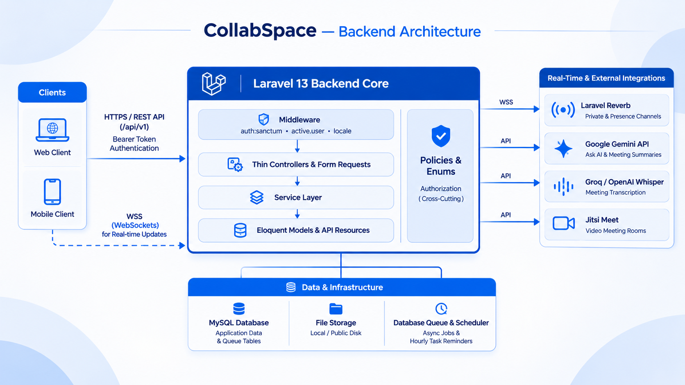
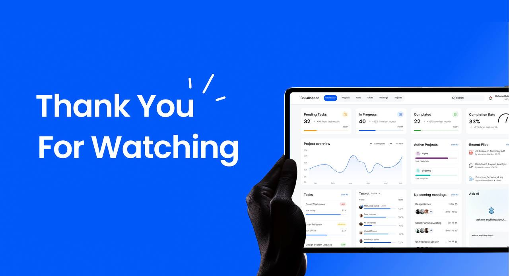

<p align="center">
  
</p>

<h1 align="center">CollabSpace</h1>

<p align="center">
  <strong>A Unified Remote Work Collaboration &amp; Project Management Backend</strong>
</p>

<p align="center">
  CollabSpace is a Laravel 13 REST API that brings project management, Kanban task tracking, team collaboration, real-time messaging, video meetings with AI transcription &amp; summarization, reporting, notifications, and a workspace-aware AI assistant into a single platform.
</p>

<p align="center">
  
  
  
  
  
</p>

---

## Comparative Analysis

<p align="center">
  
</p>

---

## Key Features

> **Note:** This repository contains the **Laravel 13 REST API backend** only; frontend and mobile clients are separate.

- **Authentication &amp; Access Control:** Sanctum Bearer tokens, Google OAuth (Socialite), account suspension enforcement (`active.user`), and contextual project roles (`project_manager`, `member`) with Last Project Manager protection.
- **Projects &amp; Teams:** Project lifecycle management (`active`, `completed`, `archived`), color-coded teams, team leaders, and member task metrics.
- **Tasks &amp; Kanban:** Project and global Kanban boards, status/priority tracking, due dates, reviewers, and automatic status-transition history (`task_status_histories`).
- **Project Files:** Secure file uploads, downloads, search, and transactional orphan-file cleanup.
- **Real-Time Chats &amp; Threads:** Direct conversations, project/team channels, threaded replies, attachments, read tracking, and WebSocket events via **Laravel Reverb**.
- **Meetings &amp; AI Summaries:** **Jitsi Meet** room scheduling, RSVP/attendance tracking, recordings, and queued **Groq / OpenAI Whisper** transcription + **Google Gemini** summarization.
- **Dashboard, Reports &amp; Global Search:** Consolidated KPI dashboard, structured status reports, and cross-resource search.
- **CollabSpace AI (Ask AI):** Multi-turn **Google Gemini** assistant with allowlisted workspace tool-calling, queued attachment analysis, regeneration, and feedback.
- **Notifications &amp; Reminders:** Queued database + private-channel (`user.{id}`) broadcast notifications and hourly due-soon/overdue task reminders.

---

## Technology Stack

| Category | Technology |
|---|---|
| **Backend &amp; Language** | Laravel `^13.17`, PHP `^8.3` |
| **Database &amp; Queues** | MySQL, Laravel Database Queue &amp; Scheduler |
| **Auth &amp; Real-Time** | Laravel Sanctum `^4.0`, Socialite (Google), Laravel Reverb `^1.14` |
| **Meetings &amp; AI** | Jitsi Meet, Google Gemini (`gemini-2.5-flash`), Groq / OpenAI Whisper |
| **Testing &amp; Quality** | Pest `^4.7`, Laravel Pint `^1.27`, GitHub Actions (`.github/workflows/ci.yml`) |
| **API Collections** | Postman (`postman/*.postman_collection.json`) |

---

## Architecture

<p align="center">
  
</p>

---

## Installation &amp; Setup

### Prerequisites
- **PHP** 8.3+ (`pdo_mysql`, `mbstring`, `openssl`, `fileinfo`, `curl`, `zip`)
- **Composer** 2.x
- **MySQL** 8.0+

### Local Setup

```bash
# 1. Clone and install dependencies
git clone https://github.com/Menna-Baligh/CollabSpace.git
cd CollabSpace
composer install

# 2. Configure environment
cp .env.example .env
php artisan key:generate
```

Update `DB_DATABASE`, `DB_USERNAME`, and `DB_PASSWORD` in `.env`.

```bash
# 3. Run migrations (and optional demo seeder)
php artisan migrate
php artisan db:seed --class=AiDemoSeeder

# 4. Link storage and start the API server
php artisan storage:link
php artisan serve
```

Once running, the interactive API documentation is available at:
`http://localhost:8000/docs/api`

### Background Workers, Scheduler &amp; Real-Time (Optional / As Needed)

```bash
# Queue worker (required for async notifications, AI attachments, meeting transcription/summaries)
php artisan queue:work --tries=3

# Scheduler (required for hourly task due-date reminders)
php artisan schedule:work

# Laravel Reverb (set BROADCAST_CONNECTION=reverb in .env first)
php artisan reverb:start
```

- **Mandatory:** `APP_KEY` and MySQL (`DB_*`) configuration.
- **Optional External Integrations:** `GOOGLE_CLIENT_*` (OAuth), `REVERB_*` (WebSockets), `JITSI_*` (custom Jitsi domain), `GEMINI_API_KEY` (Ask AI &amp; meeting summaries), `GROQ_API_KEY` / `OPENAI_API_KEY` (meeting transcription).

---

## Testing

```bash
# Run the Pest test suite
php artisan test

# Check code style with Laravel Pint
./vendor/bin/pint --test
```

---

## Acknowledgements

Special thanks to **Huma-Volve** for providing this opportunity and for being part of the experience behind building **CollabSpace**.

<p align="center">
  
</p>
